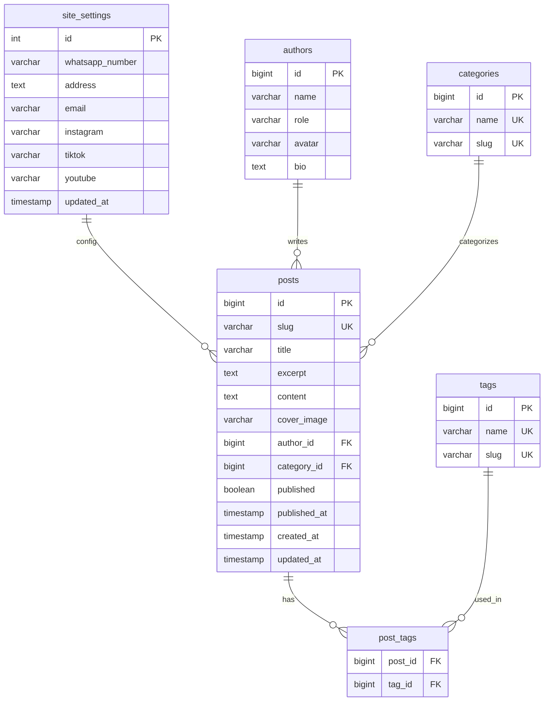

# Seger Waras — Company Profile

Website company profile untuk **Seger Waras**, perusahaan jasa desain interior. Phase 1 adalah company profile statis-semi (Home, About, Contact) dengan contact form yang redirect ke WhatsApp. Phase 2 (nanti) akan menambahkan CMS Blog.

Referensi visual: [milygroup.com](https://milygroup.com/) — clean, light, banyak whitespace, tipografi sebagai focal point, transisi halus.

---

## Features

### Phase 1 — Company Profile (sekarang)
- Halaman **Home** dengan Hero, Services, Portfolio Preview, Why Us, Process, Testimonial, dan CTA.
- Halaman **About Us** dengan Story, Visi & Misi, Tim, dan Stats perusahaan.
- Halaman **Contact** dengan form yang generate link WhatsApp prefilled (tanpa backend submission).
- Navigasi responsif (desktop + mobile drawer) dengan header fixed.
- SEO dasar: `sitemap.xml`, `robots.txt`, Open Graph, metadata per-halaman.
- Placeholder image putih/transparan untuk slot yang belum ada kontennya.
- Image optimization via `next/image` dengan remote loader Supabase Storage (disiapkan untuk phase 2).

### Phase 2 — CMS Blog (nanti, di luar scope dokumen ini)
- Tabel `posts`, `categories`, `tags`, `authors` di Supabase.
- Halaman `/blog` (list) dan `/blog/[slug]` (detail).
- Admin panel sederhana (atau pakai Supabase Studio / Decap CMS).
- Dirancang ulang di dokumen terpisah saat phase dimulai.

---

## Tech Stack

| Layer        | Pilihan                                    | Alasan |
|--------------|--------------------------------------------|--------|
| Framework    | Next.js 16 (App Router)                    | SSR/SSG, Image optimization, route handler bawaan. |
| Bahasa       | TypeScript                                 | Type safety, sesuai setup existing. |
| Styling      | Tailwind CSS v4                             | Utility-first, `@theme` untuk design tokens. |
| Font         | `next/font/google` (IBM Plex Sans / Mono / Instrument Serif) | Sudah didefinisikan di `app/fonts.ts`. |
| Hosting      | **Vercel**                                 | Zero-config deploy untuk Next.js, edge network, preview deployment. |
| Database     | **Supabase** (Postgres)                    | Disiapkan untuk phase CMS; env & client diinisiasi dari awal. |
| Object Storage | Supabase Storage (phase 2)               | Bucket publik untuk aset portofolio & blog cover. |
| Contact Form | WhatsApp deep link (client-side)           | Tanpa backend, sesuai requirement phase 1. |
| Analytics    | Vercel Analytics + Speed Insights          | Bawaan Vercel, tanpa cookie & ringan. |
| Lint/Format  | ESLint (`eslint-config-next`) + Prettier (opsional) | Standar Next.js. |
| Package Mgr  | npm                                         | Default project. |

> **Catatan arsitektur**: Walaupun phase 1 tidak butuh DB, Supabase tetap diinisiasi sekarang agar:
> 1. Tidak ada refactor besar saat CMS masuk.
> 2. Portfolio / statistik perusahaan bisa di-fetch dari DB kapan saja.
> 3. Kontak WhatsApp number & info perusahaan tersimpan di satu tempat (env + tabel `site_settings`).

---

## Environment Variables

Buat file `.env.local` (tidak di-commit):

```
# Supabase
NEXT_PUBLIC_SUPABASE_URL=https://<project-ref>.supabase.co
NEXT_PUBLIC_SUPABASE_ANON_KEY=<anon-key>
SUPABASE_SERVICE_ROLE_KEY=<service-role-key>   # untuk server-side query admin (phase 2)

# Site config
NEXT_PUBLIC_SITE_URL=https://segerwaras.id
NEXT_PUBLIC_WHATSAPP_NUMBER=6281234567890      # format intl, tanpa "+"
NEXT_PUBLIC_WHATSAPP_DEFAULT_MESSAGE=Halo%20Seger%20Waras%2C%20saya%20tertarik%20dengan%20layanan%20desain%20interior.
```

> Untuk sekarang env dibaca via helper `lib/env.ts` dengan validasi Zod supaya salah ketik terdeteksi saat build.

---

## Project Structure

Mengikuti konvensi Next.js 16 + strategi **"Store project files outside of `app`"** (lihat `node_modules/next/dist/docs/.../02-project-structure.md`).

```
seger-waras/
├── app/                              # Routing saja
│   ├── (marketing)/                  # Route group, tidak menambah URL
│   │   ├── layout.tsx                # Layout khusus marketing (Header + Footer)
│   │   ├── page.tsx                  # /         → Home
│   │   ├── tentang-kami/
│   │   │   └── page.tsx              # /tentang-kami  → About Us
│   │   └── kontak/
│   │       └── page.tsx              # /kontak    → Contact
│   ├── api/
│   │   └── og/route.tsx              # OG image generator (optional, phase 2)
│   ├── icon.svg                      # Favicon
│   ├── opengraph-image.tsx
│   ├── sitemap.ts
│   ├── robots.ts
│   ├── layout.tsx                    # Root layout (html, body, font)
│   ├── globals.css                   # Tailwind + design tokens
│   └── fonts.ts                      # (existing)
│
├── components/                       # Komponen reusable
│   ├── layout/
│   │   ├── Header/
│   │   │   ├── index.tsx             # (existing, akan di-restyling light theme)
│   │   │   ├── NavLink.tsx           # (existing)
│   │   │   └── MobileMenu.tsx
│   │   └── Footer/
│   │       ├── index.tsx
│   │       ├── FooterLink.tsx
│   │       └── SocialLinks.tsx
│   ├── home/
│   │   ├── Hero.tsx
│   │   ├── Services.tsx
│   │   ├── PortfolioPreview.tsx
│   │   ├── WhyUs.tsx
│   │   ├── Process.tsx
│   │   ├── Testimonial.tsx
│   │   └── CTA.tsx
│   ├── about/
│   │   ├── Story.tsx
│   │   ├── VisionMission.tsx
│   │   ├── Team.tsx
│   │   └── Stats.tsx
│   ├── contact/
│   │   ├── ContactForm.tsx           # Client component → generate wa.me link
│   │   ├── ContactInfo.tsx
│   │   └── LocationMap.tsx           # Embed statis (iframe Google Maps)
│   ├── ui/                           # Primitive components
│   │   ├── Button.tsx
│   │   ├── PlaceholderImage.tsx      # Render box putih/transparan + label
│   │   ├── Section.tsx               # Wrapper section + heading
│   │   ├── Container.tsx             # max-w-7xl wrapper
│   │   ├── Typography.tsx            # H1, H2, Lead, Body, Mono
│   │   └── Icon.tsx                  # Wrapper icon (lucide-react)
│   └── seo/
│       └── JsonLd.tsx
│
├── lib/                              # Business logic & helpers
│   ├── env.ts                        # Validated env (Zod)
│   ├── supabase/
│   │   ├── client.ts                 # createBrowserClient
│   │   └── server.ts                 # createServerClient
│   ├── site.ts                       # Konstanta site (nama, tagline, nav links)
│   ├── whatsapp.ts                   # buildWhatsAppLink()
│   └── utils.ts                      # cn(), formatDate(), dsb
│
├── public/                           # Aset statis
│   ├── images/                       # (kosong dulu, akan diisi saat ada aset)
│   └── fonts/                        # (kosong, font via next/font)
│
├── types/                            # Shared TS types
│   ├── site.ts
│   └── content.ts                    # PortfolioItem, Testimonial, TeamMember, dsb
│
├── data/                             # Static content (phase 1) — dipindah ke Supabase di phase 2
│   ├── services.ts
│   ├── portfolio.ts
│   ├── testimonials.ts
│   ├── team.ts
│   └── process.ts
│
├── next.config.ts
├── tailwind.config.ts                # (jika ada, atau pakai @theme di globals.css)
├── package.json
└── tsconfig.json
```

---

## Routing Map

| URL              | File                                              | Catatan |
|------------------|---------------------------------------------------|---------|
| `/`              | `app/(marketing)/page.tsx`                        | Home |
| `/tentang-kami`  | `app/(marketing)/tentang-kami/page.tsx`           | About (slug ID untuk SEO lokal) |
| `/kontak`        | `app/(marketing)/kontak/page.tsx`                 | Contact |
| `/sitemap.xml`   | `app/sitemap.ts`                                  | Generated |
| `/robots.txt`    | `app/robots.ts`                                   | Generated |
| `/icon.svg`      | `app/icon.svg`                                    | Favicon |

> **Keputusan slug**: Bahasa Indonesia (`/tentang-kami`, `/kontak`) untuk konsistensi dengan copy dan SEO lokal. `about` & `contact` dipakai sebagai `href` internal di `lib/site.ts` untuk type-safety.

---

## Halaman & Section Breakdown

### 1. Home (`/`)

| # | Section            | Tujuan                                              | Data source (phase 1) |
|---|--------------------|-----------------------------------------------------|-----------------------|
| 1 | **Hero**           | Tangkap perhatian + CTA primer                      | Statis (`lib/site.ts`) |
| 2 | **Services**       | 4–6 layanan utama (Desain Interior Rumah, Kantor, dll) | `data/services.ts`   |
| 3 | **Portfolio Preview** | 4–6 proyek terbaik sebagai teaser                | `data/portfolio.ts` (placeholder image) |
| 4 | **Why Us**         | 4–6 value props (Konsultasi Gratis, Tim Berpengalaman, dst) | `data/services.ts` |
| 5 | **Process**        | Alur kerja 4–5 langkah (Konsultasi → Konsep → 3D → Eksekusi) | `data/process.ts` |
| 6 | **Testimonial**    | 2–3 quote klien                                     | `data/testimonials.ts` |
| 7 | **CTA**            | Ajakan konsultasi, buka WhatsApp                   | Statis                |

### 2. About Us (`/tentang-kami`)

| # | Section           | Tujuan                              | Data source |
|---|-------------------|-------------------------------------|-------------|
| 1 | **Story**         | Cerita singkat + tahun berdiri     | Statis      |
| 2 | **Vision & Mission** | Visi & misi perusahaan           | Statis      |
| 3 | **Stats**         | Angka penting (tahun, proyek, klien) | Statis     |
| 4 | **Team**          | Foto + nama + peran anggota tim     | `data/team.ts` (placeholder image) |

### 3. Contact (`/kontak`)

| # | Section           | Tujuan                                       |
|---|-------------------|----------------------------------------------|
| 1 | **ContactForm**   | Form (nama, email, jenis proyek, pesan) → klik submit buka `wa.me/<number>?text=...` di tab baru |
| 2 | **ContactInfo**   | Alamat, email, nomor telepon, jam kerja, tautan sosial |
| 3 | **LocationMap**   | Embed Google Maps statis (iframe)           |

---

## Komponen Kunci

### `PlaceholderImage` (penting — untuk image yang belum tersedia)

```tsx
// Kontrak komponen
type PlaceholderImageProps = {
  ratio?: "1/1" | "4/3" | "16/9" | "21/9" | "3/4";
  label?: string;        // opsional, mis. "Portfolio — Hunian BSD"
  className?: string;
};
```

**Render**: `<div>` dengan `aspect-ratio` sesuai prop, `bg-white`, border tipis `border-neutral-200`, opsional `ring-1 ring-dashed` agar jelas placeholder, plus teks `label` kecil di tengah dalam `font-mono text-neutral-400`. Tidak pakai `<Image>` dari Next.js — placeholder adalah native div, jadi tidak ada network call.

Saat aset asli sudah ada, swap ke:
```tsx
<Image src={url} alt={alt} fill className="object-cover" />
```
dengan `remotePatterns` di `next.config.ts` untuk domain Supabase Storage.

### `ContactForm` (alur kerja)

1. User isi field (nama, email, jenis proyek, pesan, opsional: tanggal acara).
2. State lokal `useState` — tidak ada `fetch`/submit server.
3. Validasi client-side: required field + format email.
4. Saat submit:
   - Compose string pesan: `Halo Seger Waras,\n\nSaya *<nama>* (<email>).\nJenis proyek: <jenis>.\n\n<pesan>`
   - `window.open(buildWhatsAppLink(number, message), "_blank", "noopener,noreferrer")`
5. Tampilkan toast/inline message "Membuka WhatsApp…" sebentar.

`buildWhatsAppLink(number, text)`:
- Mengembalikan `https://wa.me/<intl-number>?text=<urlencoded-text>`.
- Nomor dari `NEXT_PUBLIC_WHATSAPP_NUMBER`.
- Pesan di-encode via `encodeURIComponent` (sudah cukup, tidak perlu lib tambahan).

### `Button`
- Variants: `primary` (hitam solid), `secondary` (outline), `ghost` (text-only), `whatsapp` (ikon WA + hijau brand).
- Sizes: `sm`, `md`, `lg`.
- Built di atas `<button>` / `<a>` polymorphic, **bukan** `@radix-ui` agar dependency minimal di phase 1.

### `Section` & `Container`
- `<Container>` → `mx-auto max-w-7xl px-6`.
- `<Section>` → `<section>` + `py-20 md:py-28` + optional `id` & `aria-labelledby`.

### `Header` (restyling)
- Light theme: `bg-white/80 backdrop-blur`, `text-neutral-900`, border `border-neutral-200`.
- Tetap fixed top, dengan transisi `bg-white/0` → `bg-white/80` saat scroll (pakai `useEffect` + scroll listener, atau IntersectionObserver di sentinel).
- Logo placeholder: text "Seger Waras" dalam `font-serif` (Instrument Serif).
- CTA "Konsultasi" di kanan yang link ke `/kontak`.

### `Footer`
- Multi-kolom: Brand & deskripsi, Navigasi, Kontak, Sosial.
- Baris bawah: copyright + "Design by ..." (siap di-rename saat collaborator ditambahkan).

---

## Design System

### Prinsip
- **Clean & breathable**: banyak whitespace, padding section besar (py-20/28), max-width konten 7xl.
- **Tipografi-led**: karena banyak blok teks & tidak ada foto, font jadi elemen visual utama.
- **Warna netral + satu aksen** — tema *natural & tenang* sesuai identitas "Seger Waras".
- **Image-led saat aset ready**: section dengan gambar akan dominan, bukan teks.

### Color Palette (Tailwind v4 via `@theme` di `globals.css`)

| Token              | Hex        | Tailwind name       | Penggunaan |
|--------------------|------------|---------------------|------------|
| `--color-canvas`   | `#FAFAF7`  | `bg-canvas`         | Background utama — putih hangat (warm white), tidak pure white |
| `--color-ink`      | `#0E0E0C`  | `text-ink`          | Teks utama, hampir hitam |
| `--color-muted`    | `#6B6B66`  | `text-muted`        | Teks sekunder, caption |
| `--color-line`     | `#E7E5DF`  | `border-line`       | Garis/border halus |
| `--color-sage`     | `#5B6B4B`  | `bg-sage` / `text-sage` | Aksen utama — hijau sage, merepresentasikan "seger" & "alam" |
| `--color-clay`     | `#C9B79A`  | `bg-clay`           | Aksen sekunder — earth tone, hangat |
| `--color-wa`       | `#25D366`  | `bg-whatsapp`       | Tombol WhatsApp saja |

Selaras dengan nuansa milygroup (natural, earthy) + identitas "Seger Waras" (segar/alami).

### Typography

| Token           | Font                | Weight | Penggunaan |
|-----------------|---------------------|--------|------------|
| `font-sans`     | IBM Plex Sans       | 400/500/600 | Body, paragraf, button |
| `font-serif`    | Instrument Serif    | 400    | H1/H2, logo, display quote |
| `font-mono`     | IBM Plex Mono       | 400/500/600 | Label, eyebrow, kode kecil, nav |

**Skala tipografi** (Tailwind defaults cukup, dengan beberapa override):
- Display: `text-5xl md:text-7xl font-serif leading-[1.05] tracking-tight`
- H2: `text-3xl md:text-5xl font-serif`
- H3: `text-xl md:text-2xl font-sans font-medium`
- Body: `text-base md:text-lg text-ink leading-relaxed`
- Muted: `text-sm text-muted`
- Eyebrow: `text-xs font-mono uppercase tracking-[0.2em] text-sage` (di atas judul section, ala milygroup "WHY MILY GROUP?")

### Spacing & Layout
- Section vertical: `py-20 md:py-28`.
- Container: `max-w-7xl mx-auto px-6 md:px-10`.
- Grid portfolio: `grid-cols-1 sm:grid-cols-2 lg:grid-cols-3 gap-6`.

### Motion
- Transisi hover/CTA: `transition-colors duration-200`.
- Fade-in saat section masuk viewport: pakai CSS `@starting-style` + `animation` Tailwind, atau `motion/react` (opsional, 1 lib kecil).
- Hormati `prefers-reduced-motion`.

---

## Data Model (Supabase Schema)

> Phase 1 **tidak wajib** membuat tabel — semua konten disimpan di `data/*.ts`. Skema di bawah didefinisikan **sekarang** agar phase 2 (CMS) tinggal ON, tanpa migrasi breaking.



> `posts.content` disimpan sebagai Markdown; rendering via `react-markdown` + `remark-gfm` (phase 2).

---

## Component Architecture (ringkas)

```
app/layout.tsx                  # html, body, font vars, <Header/>, <Footer/>
└── app/(marketing)/layout.tsx  # <main>{children}</main> + padding-top untuk fixed header
    ├── page.tsx                # Home
    │   ├── <Hero />
    │   ├── <Services />
    │   ├── <PortfolioPreview />
    │   ├── <WhyUs />
    │   ├── <Process />
    │   ├── <Testimonial />
    │   └── <CTA />
    ├── tentang-kami/page.tsx
    │   ├── <Story />
    │   ├── <VisionMission />
    │   ├── <Stats />
    │   └── <Team />
    └── kontak/page.tsx
        ├── <ContactForm />     # "use client" — form + WA redirect
        ├── <ContactInfo />
        └── <LocationMap />
```

Prinsip:
- Semua section di-halaman adalah **server component** kecuali butuh interaksi (form, drawer, scroll listener).
- Data dari `data/*.ts` di-import langsung di server component.
- Tidak ada global state / context untuk phase 1.

---

## SEO & Performance

- **Metadata** per-halaman via `export const metadata` (atau `generateMetadata` jika dinamis).
- **Open Graph** + Twitter Card di root layout + override per halaman.
- **JSON-LD** `Organization` schema di root layout; `LocalBusiness` di `/kontak`.
- **`sitemap.ts`** generate sitemap dari daftar route + (nanti) posts.
- **`robots.ts`** allow all + reference sitemap.
- **Image**: `next/image` dengan `placeholder="blur"` (saat gambar ready) atau komponen `PlaceholderImage` (sementara).
- **Font**: sudah via `next/font` → zero CLS, no FOUT.
- **Vercel Analytics** + **Speed Insights** di root layout.
- **Lighthouse** target: Performance ≥ 90, Accessibility ≥ 95, SEO = 100.

---

## Aksesibilitas

- Semantic HTML: `<header>`, `<nav>`, `<main>`, `<section aria-labelledby>`, `<footer>`.
- Focus ring visible (override default Tailwind ring color → `ring-sage`).
- Skip-to-content link di root layout.
- Form fields pakai `<label htmlFor>` + `aria-describedby` untuk error.
- Kontras warna teks遵守 WCAG AA.
- Reduce-motion: bungkus animasi dengan `@media (prefers-reduced-motion: reduce)`.

---

## Deployment

1. Push ke GitHub.
2. Connect repo ke Vercel.
3. Set env vars di Vercel dashboard (lihat section Environment Variables).
4. Domain custom `segerwaras.id` (atau sesuai) ditambahkan di Vercel Domains.
5. Preview deployment otomatis untuk setiap PR.
6. **Tidak perlu setup Supabase** untuk phase 1; env vars Supabase sudah didefinisikan tapi diabaikan sampai phase 2 (env akan divalidasi di `lib/env.ts` dengan schema yang menandai `SUPABASE_*` sebagai optional di phase 1).

---

## TODO / Future Considerations

- [ ] Tentukan palet warna final (nama hex bisa berubah setelah diskusi brand).
- [ ] Kumpulkan aset foto (portofolio, tim, before/after) — sementara pakai `PlaceholderImage`.
- [ ] Tulis copy final untuk setiap section (Story, Visi/Misi, Why Us, dsb).
- [ ] Tentukan link Google Maps untuk `LocationMap`.
- [ ] Siapkan logo (saat ini pakai text wordmark).
- [ ] (Phase 2) Pilih CMS approach: Supabase Studio manual vs Decap CMS vs custom admin.

---

## ©️ Copyright

&copy; 2026 Seger Waras — Jasa Desain Interior.
